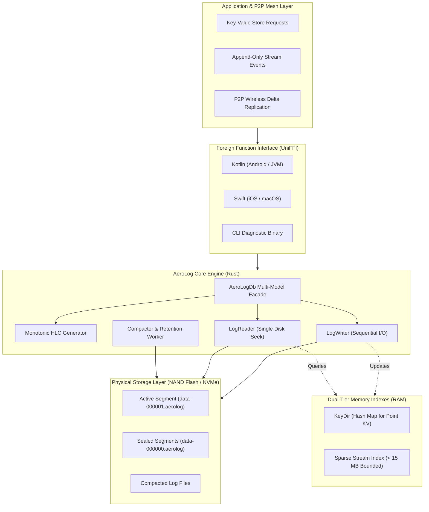

# AeroLog Documentation

> **AeroLog** is a universal, local-first, multi-model storage engine engineered from first principles in pure **Rust**.

Designed specifically for edge computing, off-grid hardware, wireless P2P mesh synchronization, and mobile platforms, AeroLog replaces traditional page-based B-Tree write amplification with a sequential **Append-Only Bitcask Log**, hardware-accelerated CRC32 checksums, memory-bounded dual-tier indexing, and monotonic Hybrid Logical Clocks (HLC).

---

## Architectural Topology

The diagram below illustrates AeroLog's data pipeline from consumer application layers down to physical disk segments:



---

## Core System Highlights

| Capability | Specification | Architectural Advantage |
| :--- | :--- | :--- |
| **Write Performance** | Pure Sequential $O(1)$ Append | > 200,000 writes/sec; minimizes NAND flash memory wear |
| **Point Read Latency** | Direct In-Memory Coordinate Seek | Single disk seek per key; zero B-Tree page traversal overhead |
| **Memory Footprint** | Bounded < 15 MB RSS | Dual-tier indexing keeps streaming logs from overflowing RAM |
| **Data Integrity** | Hardware CRC32-IEEE per Record | Instant torn-write isolation on sudden battery pull or crash |
| **Causality & Sync** | Monotonic Hybrid Logical Clock | Deterministic Last-Write-Wins (LWW) without NTP dependencies |
| **Structured Codec** | Zero-Dependency Binary CBOR | RFC 8949 compliance; no external C/C++ parser vulnerabilities |
| **Multi-Language** | Mozilla UniFFI v0.32 Scaffolding | Byte-for-byte binary parity on Android, JVM, iOS, and macOS |

---

## Quick Look: Multi-Language Usage

=== "Rust"

    ```rust
    use aerolog_core::{AeroLogDb, AeroLogConfig};

    fn main() -> aerolog_core::Result<()> {
        let config = AeroLogConfig::new("./storage_data");
        let db = AeroLogDb::open(config)?;

        // Mutable Key-Value Point Write
        db.put("users", "usr_101", b"{\"name\":\"Alice\",\"role\":\"lead\"}")?;

        // Point Read via KeyDir Index
        if let Some(payload) = db.get("users", "usr_101")? {
            println!("User payload: {}", String::from_utf8_lossy(&payload));
        }

        // Bounded Append-Only Event Stream
        let stream = db.stream("chat:room_mesh")?;
        stream.append(b"{\"sender\":\"Alice\",\"msg\":\"P2P link established\"}")?;

        Ok(())
    }
    ```

=== "Kotlin (Android/JVM)"

    ```kotlin
    import io.aerolog.uniffi.FfiAeroLogDb

    fun main() {
        val db = FfiAeroLogDb.open("./storage_data", maxSegmentSizeBytes = 64UL * 1024UL * 1024UL)
        db.use { engine ->
            // Insert or update record
            engine.put("users", "usr_101", "{\"name\":\"Alice\"}".toByteArray())

            // Point read
            val user = engine.get("users", "usr_101")
            println("Retrieved: ${user?.decodeToString()}")

            // Append to stream
            val stream = engine.stream("sensor_telemetry")
            stream.append("{\"temp\": 24.5}".toByteArray())
        }
    }
    ```

=== "Swift (iOS/macOS)"

    ```swift
    import AeroLogUniFFI
    import Foundation

    func runStorage() throws {
        let db = try FfiAeroLogDb.open(
            path: "./storage_data",
            maxSegmentSizeBytes: 64 * 1024 * 1024
        )
        defer { db.shutdown() }

        let payload = Data("{\"name\":\"Alice\"}".utf8)
        try db.put(collection: "users", key: "usr_101", value: payload)

        if let retrieved = try db.get(collection: "users", key: "usr_101") {
            print("Retrieved payload: \(String(data: retrieved, encoding: .utf8) ?? "")")
        }
    }
    ```

=== "CLI Diagnostics"

    ```bash
    # Run the comprehensive benchmark suite
    aerolog bench --records 50000 --val-size 128

    # Inspect the exact binary records inside a segment file
    aerolog inspect ./storage_data/data-000000.aerolog

    # Perform offline compaction on a sealed database
    aerolog compact ./storage_data
    ```

---

## Documentation Roadmap

* [About AeroLog](about/index.md): Conceptual overview, storage philosophy, and comparative trade-offs.
* [Getting Started](getting-started/quickstart.md): Step-by-step setup guides for Rust, Kotlin, Swift, and CLI.
* [Engine Manual](manual/index.md): Deep architectural analysis of Bitcask segments, HLC causality, and compactor workers.
* [Reference Specification](reference/binary-spec.md): Exact 32-byte header layouts, API definitions, and benchmarks.
* [Community & Governance](community/contributing.md): Contributing standards, Zero-Emoji policy, and ADRs.
