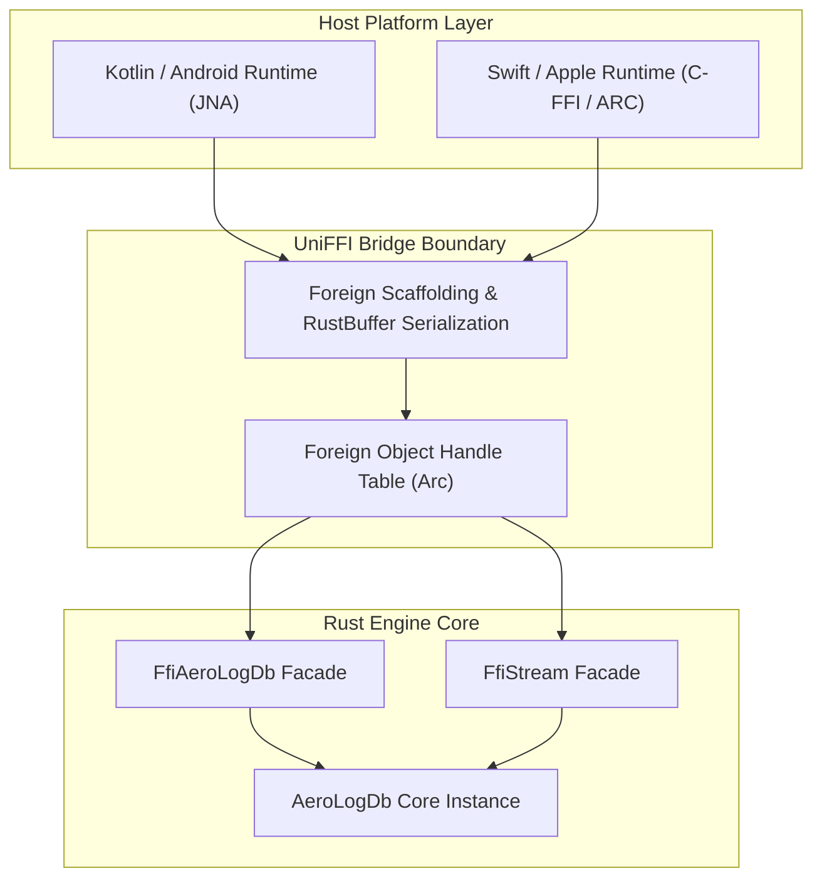

# UniFFI Cross-Platform Bridge

The `aerolog-uniffi` crate bridges the pure Rust core engine to Kotlin (Android/JVM) and Swift (iOS/macOS) using **Mozilla UniFFI v0.32**.

---

## Architectural Bridge

---

## Memory Ownership & Foreign Lifecycles

Cross-platform FFI bridges are prone to memory leaks and use-after-free bugs if handle lifetimes are not managed strictly. AeroLog enforces clean ownership through:

1. **Foreign Object Handles**: Rust engine instances are wrapped in `Arc<AeroLogDb>` and tracked in a global UniFFI handle table. The host language receives an opaque 64-bit integer pointer.
2. **Deterministic Cleanup in Kotlin**:
   `FfiAeroLogDb` implements `java.lang.AutoCloseable`. Calling `.close()` or exiting a `.use { }` block notifies Rust to release the internal `Arc`, freeing native memory immediately.
3. **Deterministic Cleanup in Swift**:
   Swift manages instances using Automatic Reference Counting (ARC). When `FfiAeroLogDb` goes out of scope, its `deinit` triggers the UniFFI pointer release callback.

---

## Error Handling Across FFI Boundaries

Rust `Result<T, AeroLogError>` cannot be passed directly as C unions across foreign ABI boundaries. UniFFI maps Rust errors into idiomatic platform exceptions:

* In Kotlin: Throws `AeroLogFfiException` (checked or runtime exception).
* In Swift: Throws Swift errors conforming to `Error` via `throws` / `try`.
