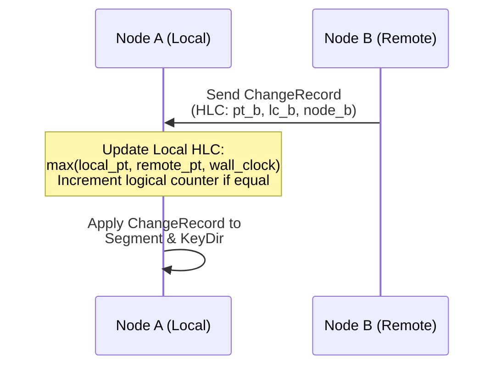

# Hybrid Logical Clocks & Causality

Distributed and off-grid databases cannot rely on physical wall clocks (NTP). Device system clocks drift, can be set backwards by users, and disagree across peers.

AeroLog integrates **Hybrid Logical Clocks (HLC)** as a first-class engine primitive, based on the formalization by Kulkarni et al.

---

## Structure of an `HlcTimestamp`

Every record header in AeroLog contains an 18-byte monotonic clock coordinate:

```rust
pub struct HlcTimestamp {
    pub physical_time: u64,    // Epoch time in milliseconds
    pub logical_counter: u16,  // Sub-millisecond event sequence
    pub node_id_hash: u64,     // Deterministic peer tie-breaker
}
```

---

## Total Causal Ordering

AeroLog achieves a strict total ordering across all mutations using tuple comparison:

$$
H_1 \lt H_2 \iff \begin{cases}
pt_1 \lt pt_2 \\
pt_1 = pt_2 \land lc_1 \lt lc_2 \\
pt_1 = pt_2 \land lc_1 = lc_2 \land node_1 \lt node_2
\end{cases}
$$

Where:
1. `physical_time` tracks the passage of wall-clock time.
2. `logical_counter` increments when multiple mutations occur within the same physical millisecond.
3. `node_id_hash` provides a mathematically deterministic tie-breaker if two independent nodes write during the exact same logical counter tick.

---

## Forward Clock Ratcheting

When an AeroLog node receives remote changes during peer synchronization:



1. The local clock generator observes `(pt_b, lc_b)`.
2. The local clock updates its internal state: $\text{next\_pt} = \max(\text{local\_pt}, \text{remote\_pt}, \text{current\_wall\_clock})$.
3. This guarantees that any subsequent write produced locally is strictly greater than all previously observed remote events, ensuring causal consistency across wireless mesh networks.
