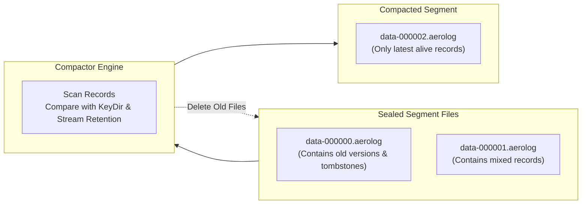

# Compaction & Retention Policies

Because AeroLog is an append-only engine, updating or deleting records creates dead data on disk. Without compaction, disk usage would grow monotonically.

The **Compactor** worker and **Retention Policy** system maintain storage efficiency and prevent disk bloat.

---

## The Log Compaction Process

Compaction runs in the background or can be triggered explicitly via `db.compact()`:



### Compaction Execution Steps
1. The compactor identifies all sealed segment files. (The active segment being written to is left untouched).
2. For each record in sealed segments:
   * **Key-Value Records**: Checks `KeyDir`. If the record matches the latest in-memory coordinate for that key and is NOT a tombstone, it is written to the new compacted segment. If an older version or tombstone exists, it is discarded.
   * **Stream Records**: Evaluates the stream's configured retention policy.
3. The new compacted segment is sealed and atomically renamed.
4. `KeyDir` and `SparseStreamIndex` update their pointers to point to the new compacted segment file and new offsets.
5. Obsolete sealed segment files are deleted (`unlink`), freeing disk blocks immediately.

---

## Pluggable Stream Retention Policies

AeroLog supports three declarative retention policies for stream partitions:

```rust
pub enum StreamRetentionPolicy {
    KeepAll,
    MaxEntries(u64),
    TimeToLive(u64), // Duration in seconds
}
```

* **`KeepAll`**: Default policy. All events are retained indefinitely until manually purged.
* **`MaxEntries(N)`**: Bounded ring buffer semantics. Compaction only retains the latest $N$ entries for the stream partition, automatically discarding older entries.
* **`TimeToLive(seconds)`**: Expiration semantics. Compaction evaluates each record's physical HLC timestamp against current time, evicting records older than the TTL.
