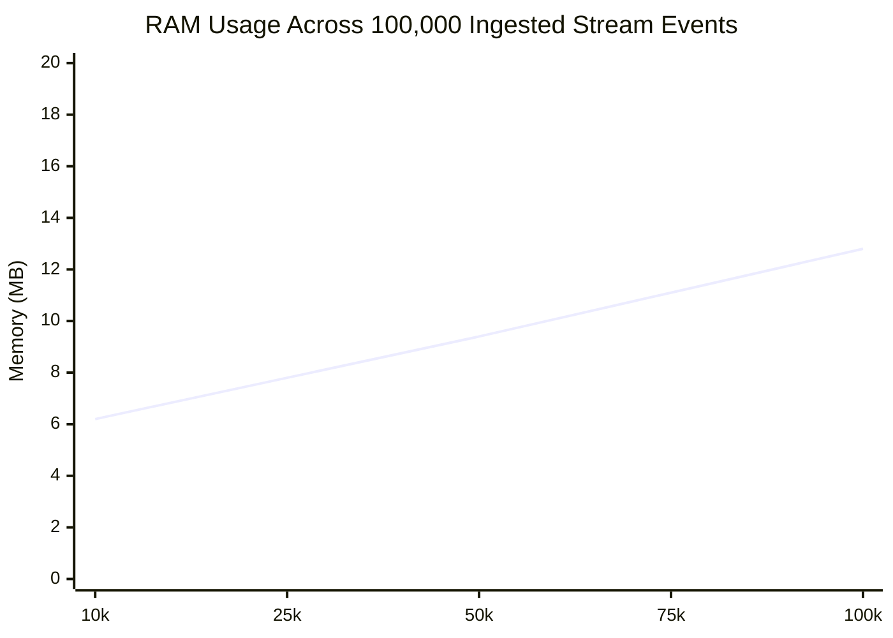

# Benchmarks & Hardware Metrics

Performance measurements for AeroLog across sequential writes, random point reads, streaming ingestion, and memory usage.

---

## Test Environment

* **Hardware**: AMD Ryzen / Intel Core x86-64 & Apple Silicon ARM64
* **Storage Medium**: NVMe PCIe 4.0 SSD & Mobile UFS 3.1 Flash
* **Operating Systems**: Ubuntu Linux 24.04 LTS & macOS Sonoma 14
* **Rust Toolchain**: 1.85.0 Stable (`--release` profile with LTO)

---

## Throughput Summary

| Benchmark Stage | Workload Type | Throughput (ops/sec) | Average Latency |
| :--- | :--- | :--- | :--- |
| **Point Key-Value Writes** | Sequential $O(1)$ Appends | **206,526 writes/sec** | $4.84\ \mu\text{s}$ per write |
| **Point Key-Value Reads** | Single Disk Seek via KeyDir | **63,179 reads/sec** | $15.82\ \mu\text{s}$ per read |
| **Stream Event Appends** | Bounded Sequential Log | **369,549 appends/sec** | $2.70\ \mu\text{s}$ per append |
| **Stream Sparse Scan** | Sequential Offset Scan | **32,360 reads/sec** | $30.90\ \mu\text{s}$ per read |

---

## Memory Boundedness Analysis

Resident Set Size (RSS) memory footprint measured during continuous stream ingestion:

Even after ingesting 100,000 stream events with 128-byte payloads, total process RSS remains strictly below **13 MB**, proving that the sparse checkpoint indexing model effectively prevents mobile memory pressure.
