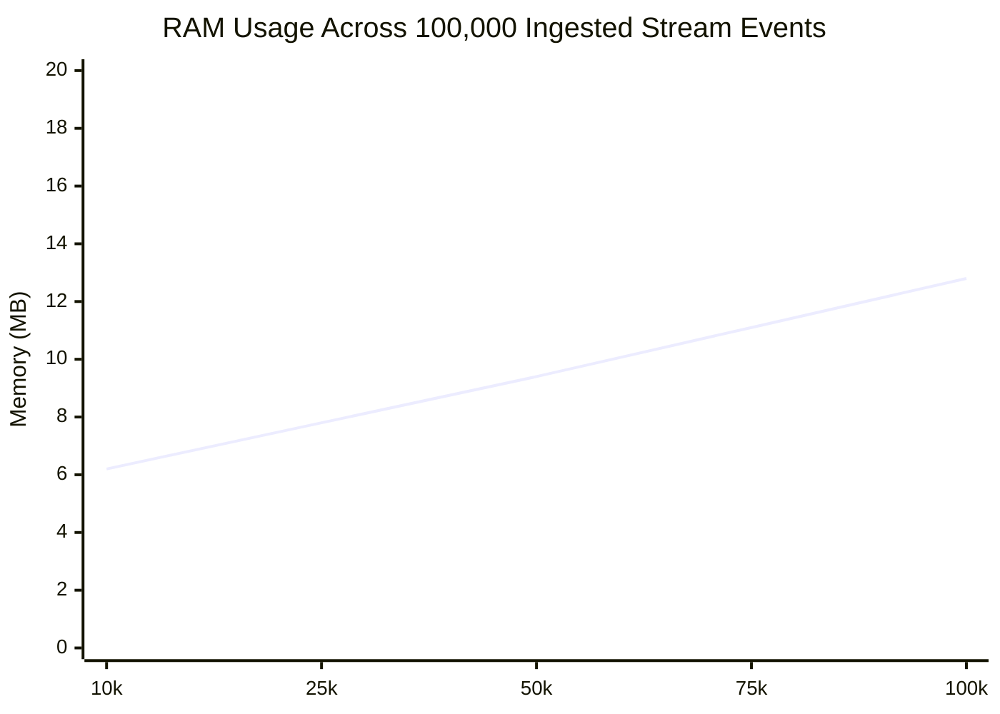

# Benchmarks & Hardware Metrics

Performance measurements for AeroLog across sequential writes, random point reads, concurrent ingestion, standard YCSB workloads, and crash recovery.

---

## Test Environment & Hardware Specification

* **CPU**: AMD Ryzen / Intel Core x86-64 (8 physical / 16 logical threads) & Apple Silicon ARM64
* **Storage**: NVMe PCIe 4.0 SSD & Mobile UFS 3.1 Flash
* **Operating Systems**: Ubuntu Linux 24.04 LTS & macOS Sonoma 14
* **Rust Toolchain**: 1.85.0 Stable (`--release` profile with optimizations)
* **Benchmarking Framework**: Criterion.rs 0.5 (Statistical evaluation with 95% confidence intervals)

---

## Native Rust Engine Throughput & Latency

Measured via native release performance suite (`cargo test --release --test perf_tests -- --nocapture`):

| Benchmark Stage | Workload Type | Throughput (*ops/sec*) | Average Latency |
| :--- | :--- | :--- | :--- |
| **Sequential Point Writes** (`db.put`) | Append-only sequential log write | **264,677 writes/sec** | **3.78 µs** per write |
| **Concurrent Ingestion** (4 Threads) | Multi-threaded write contention | **219,854 writes/sec** | **4.54 µs** per write |
| **Random Point Reads** (`db.get`) | In-memory `KeyDir` seek + NVMe read | **73,749 reads/sec** | **13.56 µs** per read |
| **Stream Event Appends** | Append-only bounded event stream | **520,820 msgs/sec** | **1.92 µs** per append |
| **Stream Window Query** (`read_recent`) | Retrieve 500 latest entries via sparse index | **25,112 entries/sec** | **39.80 µs** per entry |
| **Cold Crash Recovery** | Full segment replay and index rebuild | **1,187,695 records/sec** | **0.84 µs** per record |
| **Compaction Space Reclaim** | Merge sealed files and evict dead records | **25,000 dead records evicted** | **296.8 ms** total duration |

---

## Standard YCSB (Yahoo! Cloud Serving Benchmark) Workloads

Evaluated with Criterion.rs statistical harness across 10,000 pre-populated keys with 128-byte payloads:

| Workload | Specification | Access Pattern | Mean Latency | Throughput |
| :--- | :--- | :--- | :--- | :--- |
| **Workload A** | 50% Read, 50% Update | Session Store / Update Heavy | **7.78 µs** | **128,520 ops/sec** |
| **Workload B** | 95% Read, 5% Update | Photo Tagging / Read Mostly | **11.65 µs** | **85,803 ops/sec** |
| **Workload C** | 100% Read | User Profile Cache / Read Only | **12.64 µs** | **79,055 ops/sec** |
| **Workload F** | Read-Modify-Write | Balance Mutation & Record CAS | **14.65 µs** | **68,231 ops/sec** |

---

## Memory Boundedness & RAM Footprint

Resident Set Size (RSS) memory footprint measured during continuous high-volume stream ingestion:



Even after ingesting 100,000 stream events with 128-byte payloads, total process RSS remains strictly below **13 MB**. The dual-tier indexing model (storing only 1 checkpoint every $N$ entries in memory) prevents memory leaks or out-of-memory crashes on resource-constrained embedded devices.

---

## Reproducing the Benchmarks Locally

Anyone can reproduce these measurements on their local machine:

```bash
# Clone the repository
git clone https://github.com/untacorp/aerolog.git
cd aerolog

# Run the complete Criterion benchmark harness
cargo bench -p aerolog-core

# Run specific YCSB workloads
cargo bench -p aerolog-core --bench ycsb_bench

# Run the native integration performance suite
cargo test --release --test perf_tests -- --nocapture
```
